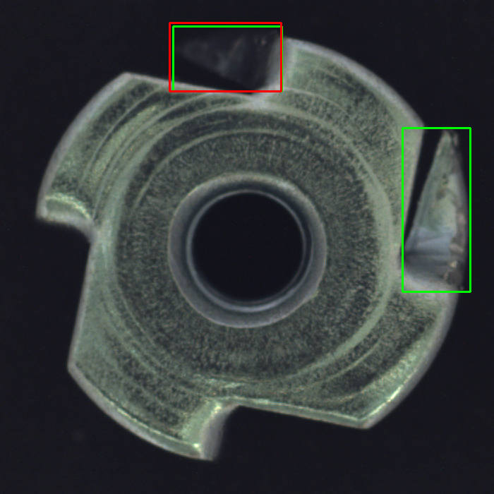
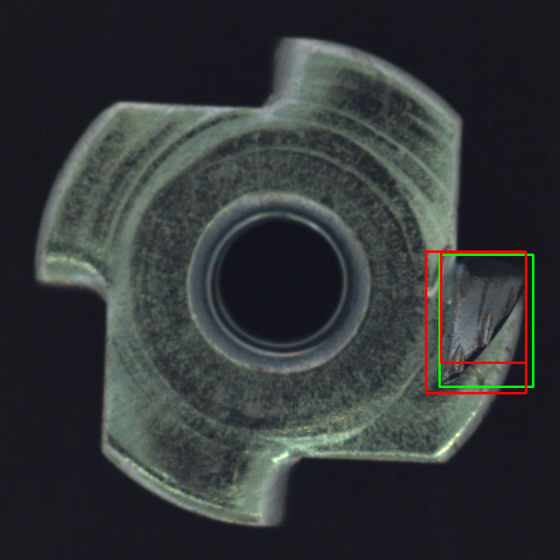
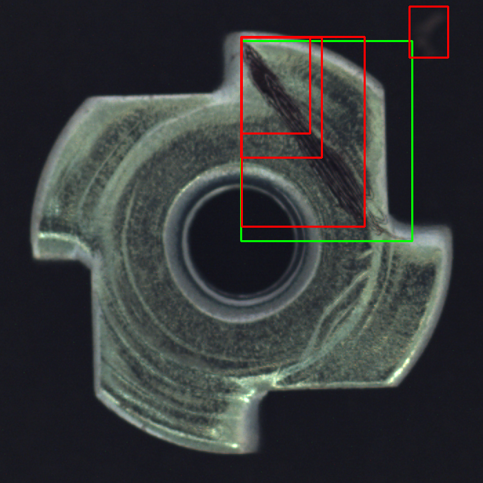
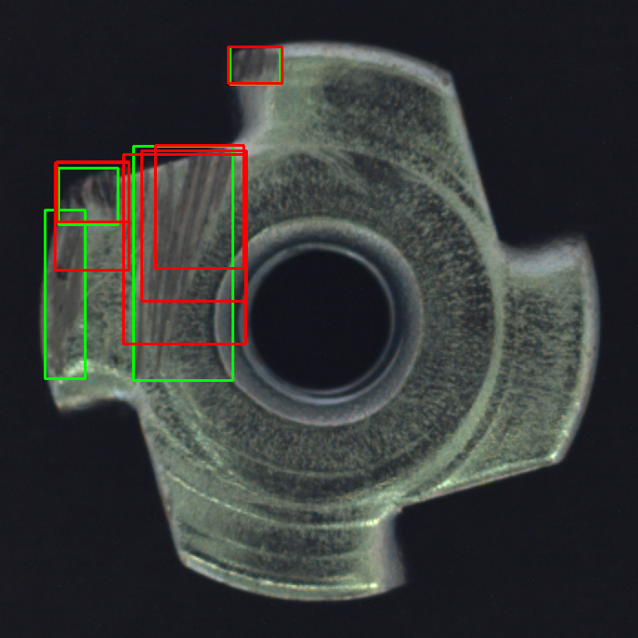
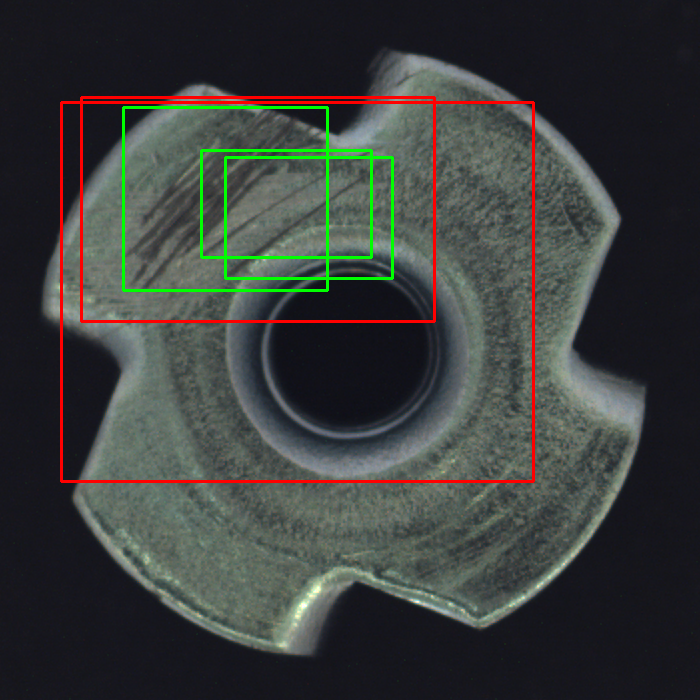

# Metal nut defect detector: findings

Prepared for InSiSo Technologies Computer Vision Intern take-home. The results below come from executed runs in this repository. The model was trained and evaluated on a custom split of MVTec AD; these are not official benchmark results.

## Method

MVTec AD `metal_nut` pixel masks are converted into one axis-aligned bounding box per 8-connected anomalous region. A single `defect` class is used because the target is localization of any defect. Normal images receive empty annotations. The custom split combines normal training images with the original test images, then splits by original image within each defect folder (seed 42; target 70/15/15). This yielded 335 images: 233 train, 48 validation, and 54 test; the test split has 25 boxes and validation has 14. This makes supervised training possible but differs from the official anomaly-detection protocol. No source image crosses splits. See `data/metal_nut_yolo/manifest.csv` for exact membership.

Both runs used Ultralytics YOLO11 nano, pretrained `yolo11n.pt`, seed 42, batch 8, a maximum of 100 epochs with patience 20, and best checkpoint selection by validation. The 640 px baseline stopped at epoch 83; the 416 px experiment stopped at epoch 70. Both trained on MPS on an Apple M5 Max. Environment: macOS 27.2, Python 3.12.7, PyTorch 2.15.0, Ultralytics 8.3.221, OpenCV 4.12.0, ONNX Runtime 1.23.2. PyTorch warned that one MPS operation lacks a deterministic implementation despite `deterministic=True`, so exact repeatability is not guaranteed.

## Results

| Experiment | Input | Precision | Recall | mAP@0.5 | CPU median / p95 | Notes |
|---|---:|---:|---:|---:|---:|---|
| Baseline | 640 | 0.576 | 0.760 | 0.770 | 22.75 / 24.20 ms | 54 held-out images, 25 GT boxes |
| Resolution experiment | 416 | 0.630 | 0.680 | 0.791 | 13.75 / 14.40 ms | 54 held-out images, same 25 GT boxes |

Evaluation uses confidence >= 0.25 for precision/recall, greedy one-to-one matching at IoU >= 0.5, and 101-point interpolated single-class AP over detections ranked at confidence >= 0.001. Validation results were used to compare the input sizes before the final test evaluation. At the same protocol, validation metrics were: baseline precision 0.619, recall 0.929, mAP@0.5 0.897; experiment precision 0.636, recall 1.000, mAP@0.5 0.959.

### Error analysis

Review the generated `failure_cases/index.csv` and images from each final test evaluation. Green is the mask-derived ground truth; red is a prediction above 0.25. Include at least five actual images with IDs, prediction/ground truth, and image-based analysis. Do not infer a cause from the metric alone.

| Image ID | Actual error at 640 px, confidence >= 0.25 | Visual observation and likely cause |
|---|---|---|
| `test__bent__000.png` | 2 GT boxes in px: `[245,37,399,129]`, `[571,181,667,414]`; 1 prediction `[241,33,399,130]` at 0.649; right box missed | The top prediction closely covers one mask region, but a spatially separate right-edge region is missed. The separate damaged patches may make the model focus on only one. |
| `test__bent__020.png` | 1 GT `[550,318,666,483]`; predictions `[533,314,658,491]` at 0.637 and `[552,316,657,453]` at 0.584; 1 duplicate FP | Both boxes cover the same bent right edge, but only one can match the annotation. Duplicate localization may be reduced by stricter NMS. |
| `test__color__008.png` | 1 GT `[349,60,597,350]`; 4 predictions at 0.505, 0.353, 0.282, 0.264; 3 FP | One partial box matches the large color-defect region; smaller overlapping boxes and a box near the top edge are extra detections. The broad, high-contrast region and reflective edge appear to trigger fragmented boxes. |
| `test__scratch__004.png` | 4 GT boxes; 6 predictions; 3 TP, 3 FP, 1 miss `[50,230,94,415]` | Several boxes overlap the same scratch regions while a narrow lower-left region is missed. Thin nearby scratches likely cause duplicate boxes and missed components. |
| `test__scratch__006.png` | 3 GT boxes; 2 broad predictions at 0.306 and 0.283; 0 TP, 3 misses | The annotated scratch regions are close together on a textured surface. The predictions are too broad to reach IoU 0.5 with any target, suggesting localization is confused by clustered, low-contrast marks. |

If fewer than five errors occur at the chosen threshold, state the observed number and provide a justified threshold study of actual held-out examples instead.

Annotated examples (green = ground truth, red = prediction):

The selected annotated examples are included with MVTec AD attribution and license details in `report/failure_cases/ATTRIBUTION.md`.

### Improvement experiment

One factor changed: training and inference image size from 640 to 416 pixels; checkpoint family, seed, batch, training device, split, confidence threshold, and IoU matching stayed fixed. On validation, the 416 model scored better on all three reported quality metrics. On test it had slightly higher precision and mAP, but recall fell by 0.08. Its median end-to-end CPU latency was 13.75 ms versus 22.75 ms, a 39.6% reduction; it still misses a 10 ms budget.

### ONNX and CPU timing

Exported models: `models/metal_nut_defect.onnx` (640 px, 10.6 MB) and `models/metal_nut_defect_416.onnx` (416 px, 10.5 MB). CPU: Apple M5 Max, macOS 27.2, ONNX Runtime 1.23.2 CPUExecutionProvider. Measurement includes image loading, preprocessing, ONNX inference, and postprocessing/NMS. Warmup: 10; measured runs: 100. Median/p95: 22.75/24.20 ms at 640 px and 13.75/14.40 ms at 416 px. Timing on this Mac is not a proxy for the target edge device.

## A. Few defects and many good parts

With 30 defective images and 3,000 good images, I would first define what counts as a defect with the quality team and split data by part, production lot, and capture period before doing any augmentation. I would reserve recent and representative good and defective examples for validation and a final test, then avoid allowing near-duplicate frames of the same part into different splits. Overall accuracy would be misleading: a system that calls every part good would already be 99% accurate while finding none of the defects.

I would compare two complementary approaches. A supervised detector can learn defect location from the 30 labeled examples, but it is likely to overfit and cannot cover unknown defect appearances. An anomaly detector trained on defect-free parts can learn the normal appearance and flag unusual regions; it may find previously unseen faults, though lighting and harmless surface variation can also trigger alarms. I would start with a simple baseline for each and inspect localization and false alarms, not just a single aggregate score.

I would collect more defective examples from the line and label them with consistent rules. Until then, I would use only physically plausible augmentation such as modest brightness/contrast, rotation, or blur, applying every geometric transform identically to the box or mask. I would not create synthetic defects and count them as independent evidence. Thresholds would be calibrated on a validation set that reflects actual production prevalence. The decision would be based on missed-defect cost versus review/stop-line cost, reported as recall at an agreed false-alarm rate. Finally, I would validate on naturally imbalanced production batches and different shifts, lots, lighting states, and camera setups; a balanced test sample is useful for measuring defect types but cannot estimate the real false-alarm workload.

## B. Detection degrades after two weeks

I would first preserve recent failed and passed images, predictions, confidence values, timestamps, and available line metadata so the investigation uses evidence rather than anecdotes. Then I would check the capture path: focus, camera position, lens cleanliness, lighting intensity and angle, exposure, vibration, motion blur, and whether the part presentation changed. These can change pixels without any model change. I would compare the live image histogram and sharpness with reference samples, and check that a known reference image still produces the expected result.

Next I would verify deployment integrity: model file checksum, preprocessing resize and color order, normalization, class mapping, confidence and NMS thresholds, ONNX Runtime/provider versions, and whether inference is completing before the controller deadline. I would check logs for dropped frames, stale results, queue buildup, or a recent software/configuration update. This separates a capture or integration fault from a change in what the model sees.

Then I would compare a labeled sample of recent production images against the original train, validation, and test distributions. I would stratify results by defect type, product lot, shift, camera, and lighting state, and quantify precision/recall with uncertainty where sample counts are small. I would ask inspectors to label both false negatives and false alarms, and check whether a genuinely new defect type or appearance has appeared. I would not immediately retrain on unreviewed model outputs, since that could reinforce mistakes.

If capture or preprocessing is at fault, I would fix and verify that first. If the data has shifted, I would collect representative labels, update training data, retrain or recalibrate only on the development split, and re-evaluate on a later untouched set. I would deploy a candidate in shadow mode, compare it with the current system against agreed safety and false-alarm limits, and keep a rollback path. Continued monitoring by lot, time, and defect type would catch renewed degradation.

## C. 40 ms model, 10 ms controller budget

I would first clarify what the 10 ms budget includes and measure each stage separately: image acquisition/transfer, preprocessing, model forward pass, decoding/NMS, and controller communication. I would benchmark repeated warmed runs on the actual target CPU under realistic load. A 40 ms desktop result or a model-only timing cannot identify the bottleneck on the production controller.

If neural inference dominates, I would try a smaller model and then lower input resolution, measuring recall specifically on the smallest defects as well as overall precision, recall, and latency. Quantization (for example INT8 with representative calibration images) or structured pruning may help, but both need accuracy checks and hardware/runtime support. I would also evaluate an optimized inference runtime, graph simplification, operator fusion, and any accelerator already supported by the device. I would change one factor at a time and retain a known-good checkpoint.

If preprocessing or postprocessing consumes much of the budget, I would simplify copies and color conversions, optimize NMS, and use a fixed region of interest only if the fixture guarantees the nut remains in that area. A pipeline can overlap acquisition and inference or inspect selected frames if process requirements allow it, but frame skipping must not hide a brief defect. Cropping may improve both speed and effective detail, while increasing the chance of excluding a defect if alignment drifts.

I would not claim a solution until the candidate stays under 10 ms at the required percentile on the real controller and meets an agreed minimum recall, especially for critical small defects. If no option satisfies both, I would report the measured tradeoff and work with the controls team on a faster device or a revised inspection cycle time rather than silently relaxing quality.

## AI coding tools disclosure

I used OpenAI Codex in the Codex desktop environment to draft the data conversion, YOLO training/evaluation, ONNX export, CPU benchmark scripts, and this report structure. I chose the one-class setup, connected-component boxes, image-level split, YOLO11n checkpoint, 640/416 comparison, and matching thresholds. I reviewed generated overlays and failure images and checked all reported metrics against the run outputs. The environment was macOS 27.2 on an Apple M5 Max with Python 3.12.7, PyTorch 2.15.0, Ultralytics 8.3.221, OpenCV 4.12.0, and ONNX Runtime 1.23.2.

Three AI-assisted implementation/run mistakes were caught and corrected. The initial OpenCV call passed `8` as a positional `labels` argument instead of the connectivity argument; I changed it to `connectivity=8` and verified two components with a synthetic mask. A second review found that `train/good/000.png` and `test/good/000.png` could overwrite each other in the prepared dataset. Output names now include the source folders, and a synthetic duplicate-basename check confirmed each image has its own label. The first 416-pixel training attempt also ran on CPU while the baseline ran on MPS; I stopped it and reran on MPS so the final comparison changes only image size. MPS logged that one operation lacks deterministic support despite the seed and deterministic flag, so exact repeatability is limited. No autonomous external agents or repository-specific agent rules were used; commands are documented in the README.

## Submission details

- Education: first-year undergraduate student pursuing BITS Pilani CSE (BSc Hons) and CS & AI at Scaler School of Tech; expected graduation in 2030 for both.
- Earliest available start date: 7 January 2027, after returning to Bengaluru from winter break.
- Repository: [BENi-Aditya/insiso-computer-vision-take-home](https://github.com/BENi-Aditya/insiso-computer-vision-take-home), public.
- Dataset source and terms: official MVTec AD page; do not redistribute the data. Confirm licensing before commercial use.
